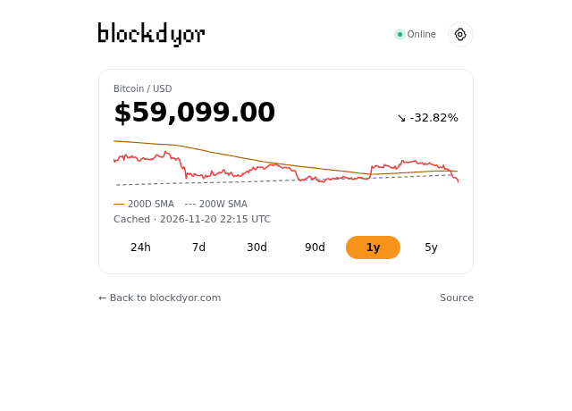
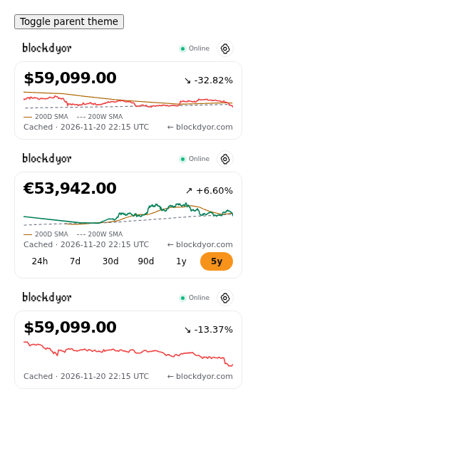

# price

A small Bitcoin price chart for a Cloudflare Worker. One pasteable runtime file, vanilla JavaScript and SVG. No framework, build step, runtime dependencies, cookies or trackers.

**Deployment target:** [price.blockdyor.com](https://price.blockdyor.com). Deploy by pasting the single Worker file, or connect the existing Worker to GitHub once and let Cloudflare deploy subsequent pushes. Publishing this repository alone does not connect a Cloudflare account.

Standalone: blockdyor logo, price, chart, range controls and a back link, with a compact 24px top margin. Direct iframes and script widgets retain a small blockdyor logo and a visible website backlink, using the same colors and font. The first price and line are rendered server-side, so they do not depend on browser JavaScript. JavaScript adds automatic refresh, hover/touch and keyboard inspection, range changes and theme switching. The 230px card uses Attegi’s orange pills and a compact tiled settings popover; optional 200D/200W SMA overlays are available on 1y and 5y.

## Screenshots

Captured from the local Worker with real API data; these images are samples, not current quotes.






## Embed

Paste either snippet into a Ghost HTML card or any HTML page. No Ghost installation, theme changes or Ghost scripts are needed in the Worker.

```html
<iframe src="https://price.blockdyor.com/?days=7" title="Bitcoin price chart" width="320" height="140" style="border:0" loading="lazy"></iframe>
```

```html
<div data-btc data-days="30"></div>
<script src="https://price.blockdyor.com/widget.js"></script>
```

The widget script supports several `[data-btc]` elements, lazy-loads titled iframes, and follows Attegi's `theme-dark` class on `<html>`. Theme changes are sent to existing frames without reloading them; both chart and logo follow the selected theme. Direct iframe embeds use the operating-system theme unless you pass `theme=light` or `theme=dark`. The linked logo opens blockdyor.com at the top level; the explicit backlink opens the site in a new tab. Existing 320 × 140 embeds still fit without scrolling; use 180px height when showing range controls.

### Parameters

Unknown parameters and invalid values are ignored in favor of the defaults. Case matters.

| Query parameter | Values | Default |
| --- | --- | --- |
| `days` | `1`, `7`, `30`, `90`, `365`, `1825` (5y) | `7` |
| `cur` | `usd`, `eur`, `gbp`, `chf` | `usd` |
| `theme` | `light`, `dark`, `auto` | `auto` |
| `controls` | `1` shows the range row in embeds | off in embeds; always on standalone |

Widget attributes: `data-days`, `data-cur`, `data-theme`, `data-controls`, `data-width` and `data-height`. Width and height accept positive integer pixel values, optionally suffixed with `px`, or integer percentages up to `100%`. Defaults: `320px` × `140px`; width never exceeds the container. Supply enough height when enabling controls, for example `data-height="180"`.

## Deploy by hand

You need only **[`src/index.js`](src/index.js)**. It is self-contained, has no imports, and exports only `export default`. This remains JavaScript: no Rust, WebAssembly, extra runtime files or build step.

1. In the Cloudflare dashboard, open **Workers & Pages → Create → Create Worker**, name it **price**, then **Deploy**.
2. Select **Edit code**, replace everything with the entire contents of `src/index.js`, then **Deploy**.
3. Open **Settings → Domains & Routes → Add → Custom domain** and enter `price.blockdyor.com`. With the zone already on Cloudflare, DNS is created automatically.
4. Optionally, under **Settings → Variables and Secrets**, add a plain-text `ALLOWED_ANCESTORS` variable. Use `https://blockdyor.com` to restrict embedding to that origin, or a space-separated list of allowed HTTP(S) origins. Default: `*`. Invalid configuration fails closed with `frame-ancestors 'none'`.

No Cloudflare API token, account ID, KV, cron, D1, paid service or CLI deployment is required for manual pasting. This repository neither requests nor reads Cloudflare credentials. The included `wrangler.toml` targets the existing Worker named `price` for optional Git-connected deployment; manual pasting still needs only `src/index.js`.

## Automatic updates from GitHub

Cloudflare Workers Builds can deploy this repository whenever `main` changes. Connect the **existing `price` Worker**, not a new Worker, under **Settings → Builds → Connect**. GitHub authorization stays in your Cloudflare dashboard; do not put Cloudflare tokens or account IDs in this repository or send them in chat.

Use these build settings:

- Repository: `blockdyor/price`
- Production branch: `main`
- Root directory: repository root (leave the default)
- Build command: `npm test` (recommended; no compilation is needed)
- Deploy command: `npx wrangler deploy` (Cloudflare's default; runs inside Cloudflare, not by the assistant)

The configuration's `name = "price"` must match the connected Worker name. `keep_vars = true` preserves dashboard-managed runtime variables such as `ALLOWED_ANCESTORS`; no `[vars]` block overwrites them. Domain routes remain dashboard-managed: the configuration has no `route`/`routes` keys and sets `workers_dev = false`, following Cloudflare's documented dashboard-routing mode. Use `price.blockdyor.com`; the `workers.dev` address is disabled by this configuration.

After connecting, a push to `main` can update production automatically. Inspect **Build history/Deployments** for the first successful run. This is deployment on Git push, not downloading source from GitHub on each visitor request. The application remains one self-contained JavaScript file with no runtime dependencies; no new release or Worker-code change is needed for this configuration update. Dashboard edits to the Worker code can be replaced by the next Git deployment, so make lasting code changes in the repository.

References: [Workers Builds](https://developers.cloudflare.com/workers/ci-cd/builds/), [build settings](https://developers.cloudflare.com/workers/ci-cd/builds/configuration/), [dashboard variables and routing](https://developers.cloudflare.com/workers/wrangler/configuration/#source-of-truth).

### After-paste checklist

- Open `/`: a price and SVG line, or calm `n/a` if the provider is unavailable. Test every range and both color themes.
- Open `/api/price?days=1`: JSON containing only `{"prices":[[time,price],...]}`. Time is Unix milliseconds, at most 300 chronological points.
- Open `/api/quote?cur=usd`: a current quote with separate publication and retrieval timestamps. Confirm the tab title equals the headline and the chart ends at that price; use reduced-motion settings to disable flashes.
- On 1y/5y, open settings and enable each SMA. Confirm real curves appear, short ranges disable the tiles, and switching ranges never restores an old curve. Escape closes settings and returns focus; outside-click dismissal preserves the clicked control’s focus.
- Open `/api/averages?days=1825&cur=usd`: `{daily:[[time,mean],...],weekly:[[time,mean],...]}`, each at most 300 points.
- Open `/favicon.png`: the same PNG favicon as blockdyor.com.
- Open `/widget.js`: JavaScript, not an HTML page.
- Put each embed snippet on a throwaway HTML page; confirm that the compact linked logo and website backlink remain visible. Only the standalone theme button and full footer are hidden. Use two widgets to check independent ranges and dimensions.
- On an Attegi page, toggle dark mode and confirm both frames follow without reloading.
- Inspect the browser's network panel: the frame requests only this Worker's origin. Inspect the response headers for CSP, `nosniff` and `no-referrer`; there must be no `X-Frame-Options`.

## Data and caching

All price data comes from **mempool.space**, without an API key: [historical prices](https://mempool.space/api/v1/historical-price?currency=USD) for the range chart, and [current prices](https://mempool.space/api/v1/prices) for the headline, tab title and rightmost chart point. [API documentation](https://mempool.space/docs/api/rest) · [Terms](https://mempool.space/terms-of-service).

- The headline, browser tab title and chart endpoint use the same quote and publication timestamp. Quotes are checked every five seconds while visible and once per minute while hidden, so the tab title can keep updating without full-speed background polling. Browsers may still throttle or suspend background tabs. The current point replaces the previous live endpoint instead of accumulating a fictitious tick for every browser poll. Historical refreshes reapply that endpoint, and the displayed line remains capped at 300 points. Older provider responses cannot move the displayed quote backwards.
- The caption shows only `YYYY-MM-DD HH:MM UTC`, using mempool's publication time, not when the Worker checked it. **Polling does not make mempool publish faster:** its current-price feed is not tick-by-tick, and the historical samples are generally hourly. The interface can remain unchanged between provider updates.
- If either displayed data source is cached, the card uses one label: `Cached · YYYY-MM-DD HH:MM UTC`. There is no separate quote/chart cache wording. The time belongs to the current quote, or the final historical sample when the quote is unavailable; it never becomes retrieval time. With no usable data the headline is `n/a` and the caption is empty. API cache headers and JSON schemas are unchanged.
- `/api/quote?cur=usd` returns `{price,currency,fetchedAt,time}`. Both timestamps are Unix milliseconds: `time` is publication time, `fetchedAt` is retrieval time. Invalid, future or more-than-one-hour-old upstream quotes are rejected. Failure returns HTTP 503 with null values and `no-store`; historical values are not substituted as current. The headline and tab title show `n/a`, while available history remains visible.
- The whole price briefly turns green on a higher displayed value or red on a lower one for 450 ms. Initial and unchanged values do not flash; reduced-motion preferences disable the animation. Prices are displayed to cents consistently in the headline and tab title.
- Historical freshness is 60 seconds for `days=1`, 300 seconds for other ranges. Historical Cache API entries retain the last good response for up to 24 hours after retrieval. A stale entry can be returned while `waitUntil` refreshes it; without a context, the Worker attempts the provider synchronously and falls back on failure.
- Fresh historical responses include `stale-while-revalidate=60`. Stale history is marked `X-Price-Cache: stale`, with `no-store` so a browser cannot extend the fallback window. Cache status appears only in the compact caption, not repeated in the chart title.
- Historical API responses contain only validated, sorted, deduplicated `[time,price]` pairs, at most 300, retaining both endpoints. Cold historical failure returns HTTP 503 with `{"prices":[]}`. The page remains HTTP 200.
- The percentage compares the current displayed quote with the first available historical sample for the selected range. The live endpoint uses the actual provider timestamp; it does not rewrite an old hourly sample's timestamp.

### Moving averages and connection status

- The gear opens tiled controls for **200-day** and **200-week simple moving averages**. They default off, apply only to 1y/5y, and retain the selection only in the current tab’s memory. The chart rescales to include enabled curves; the orange line is 200D and the gray dashed line is 200W.
- `/api/averages?days=365|1825&cur=usd|eur|gbp|chf` fetches full mempool history server-side to obtain the warmup before the displayed horizon. Each daily close is the latest observed sample in a **completed UTC day**; each weekly close is the latest sample in a **completed Monday-start UTC week**. Timestamps are exclusive period ends. These sampled closes are not guaranteed exchange OHLC closing prices, and an ISO week need not contain samples on all seven days.
- Each mean requires **200 consecutive sampled periods**. Missing periods reset the window; only the latest contiguous computed segment is plotted, so a line cannot bridge an unknown interval. Insufficient history yields an empty series, never a shortened window or fabricated curve. Completed-period means are calculated before endpoint-preserving downsampling to at most 300 points per series. Currency prices are taken directly from the provider, never converted locally.
- Averages are fetched lazily when enabled and refreshed alongside long-range history, with a five-minute edge freshness limit. Valid last-good data may be served for up to 24 hours after retrieval on provider failure, rechecking age after the failed request. Stale/error responses use `no-store`; a displayed cached average also activates the card’s single `Cached` label. No usable cache plus provider failure returns HTTP 503 with empty arrays. Short-range requests return empty arrays without contacting the provider; invalid parameters default to 365/USD.
- **Online** means the quote API was reachable, **Stale** means the quote is unavailable but usable historical data remains, and **Offline** means the browser reports offline or no usable quote/history exists. The pulse is a connectivity cue, not a trade tick; reduced motion disables it. Mempool publication cadence is unchanged.

The provider is accessed only by the Worker. Public/keyless API access remains subject to mempool's terms and is not a blanket guarantee about data licensing or uptime. Cache API entries are local to each Cloudflare data center and may be evicted; 24 hours is a maximum history age, not a durability guarantee. Free-plan request/CPU limits apply; no paid plan or bindings are enabled.

The blockdyor favicon is served through `/favicon.png`, copied byte-for-byte from the fixed site icon URL and cached for a day. The browser still requests only the Worker origin; favicon failure does not break the page.

## Privacy and security

No cookies, local storage, analytics, third-party scripts, external fonts or third-party browser requests. The logo is an inline data URI. The browser talks only to the Worker; the provider sees the Worker's request, not a direct request from the visitor. Normal Cloudflare/provider operational logging may still apply.

The page uses nonce-based script/style CSP, same-origin-only connections, no forms or objects, validated frame ancestors, `X-Content-Type-Options: nosniff` and `Referrer-Policy: no-referrer`. Query input is whitelisted before rendering. It sets no `X-Frame-Options`.

Settings use labeled toggle buttons, a keyboard-focusable dialog and explicit disabled states on short ranges. The connection live region changes only when its state changes. The chart has an accessible image label and signed percentage change; text does not depend on red/green alone. Focus the chart and use Left/Right, Home/End or Escape to inspect or dismiss a tooltip. Keyboard inspection announces the selected historical value through a permanent polite live region. Reduced-motion preferences are respected. The brand up color remains `#10b981`; the up-stroke uses `#07815a` in light mode to meet non-text contrast, and the original green in dark mode.

## Local development and tests

Use Node.js 22 or newer. No `npm install` is needed.

```sh
npm test
npm run dev
```

`npm run dev` serves `http://localhost:8787`. Restart it after editing the Worker. This plain Node server has no Cloudflare Cache API; caching is exercised by the tests with an in-memory mock. The test command explicitly runs both `test/index.test.js` and `test/averages.test.js`. Tests invoke `worker.fetch(new Request(...), env)` directly and mock external fetch/cache boundaries; client tests execute the generated script with minimal DOM/timer primitives. No Cloudflare runtime or account is needed.

If Hermes runs remotely, that server's localhost is not your desktop's localhost. Hermes' side-pane file preview disables scripts; use an inline `::preview` for an interactive captured-data preview, not as proof of a live Worker deployment.

The requested settings, status and indicator support increase the pasteable source to about 40 KB (previously about 24 KB). Raw HTML is budgeted at 32 KB; the existing 12 KB gzip regression remains. Derived series are fetched separately rather than embedded in initial HTML. Real-provider payload sizes vary. Cloudflare production CPU metrics are not available to this project’s local tests.

## Branding and license

The inline logo is blockdyor's original 852-byte WebP from `https://blockdyor.com/content/images/size/w320/2026/01/logo_test1.webp`. Colors and system font stack follow blockdyor's Attegi theme. Blog navigation, member controls and social links are deliberately omitted: this is a chart, not a Ghost site.

[AGPL-3.0-only](LICENSE). The standalone page links to the source repository. If you modify and serve it, keep an appropriate source offer for the version you serve. blockdyor branding is not a grant of trademark rights.
