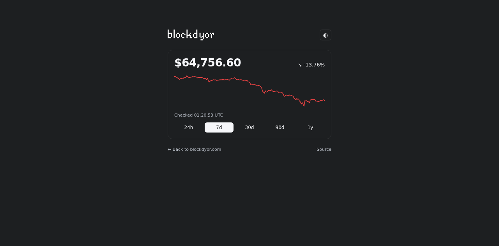

# price

A small Bitcoin price chart for a Cloudflare Worker. One pasteable runtime file, vanilla JavaScript and SVG. No framework, build step, runtime dependencies, cookies or trackers.

**Deployment target:** [price.blockdyor.com](https://price.blockdyor.com). You must deploy it yourself; publishing this repository does not create the live site.

Standalone: blockdyor logo, price, chart, range controls and a back link. Inside an iframe: just the chart. The first price and line are rendered server-side, so they do not depend on browser JavaScript. JavaScript adds automatic refresh, hover/touch and keyboard inspection, range changes and theme switching.

## Screenshots

Captured from the local Worker with real API data; these images are samples, not current quotes.




## Embed

Paste either snippet into a Ghost HTML card or any HTML page. No Ghost installation, theme changes or Ghost scripts are needed in the Worker.

```html
<iframe src="https://price.blockdyor.com/?days=7" title="Bitcoin price chart" width="320" height="140" style="border:0" loading="lazy"></iframe>
```

```html
<div data-btc data-days="30"></div>
<script src="https://price.blockdyor.com/widget.js"></script>
```

The widget script supports several `[data-btc]` elements, lazy-loads titled iframes, and follows Attegi's `theme-dark` class on `<html>`. Theme changes are sent to existing frames without reloading them. Direct iframe embeds use the operating-system theme unless you pass `theme=light` or `theme=dark`.

### Parameters

Unknown parameters and invalid values are ignored in favor of the defaults. Case matters.

| Query parameter | Values | Default |
| --- | --- | --- |
| `days` | `1`, `7`, `30`, `90`, `365` | `7` |
| `cur` | `usd`, `eur`, `gbp`, `chf` | `usd` |
| `theme` | `light`, `dark`, `auto` | `auto` |
| `controls` | `1` shows the range row in embeds | off in embeds; always on standalone |

Widget attributes: `data-days`, `data-cur`, `data-theme`, `data-controls`, `data-width` and `data-height`. Width and height accept positive integer pixel values, optionally suffixed with `px`, or integer percentages up to `100%`. Defaults: `320px` × `140px`; width never exceeds the container. Supply enough height when enabling controls, for example `data-height="180"`.

## Deploy by hand

You need only **[`src/index.js`](src/index.js)**. It is self-contained, has no imports, and exports only `export default`.

1. In the Cloudflare dashboard, open **Workers & Pages → Create → Create Worker**, name it **price**, then **Deploy**.
2. Select **Edit code**, replace everything with the entire contents of `src/index.js`, then **Deploy**.
3. Open **Settings → Domains & Routes → Add → Custom domain** and enter `price.blockdyor.com`. With the zone already on Cloudflare, DNS is created automatically.
4. Optionally, under **Settings → Variables and Secrets**, add a plain-text `ALLOWED_ANCESTORS` variable. Use `https://blockdyor.com` to restrict embedding to that origin, or a space-separated list of allowed HTTP(S) origins. Default: `*`. Invalid configuration fails closed with `frame-ancestors 'none'`.

No Cloudflare API token, account ID, KV, cron, D1, paid service or CLI deployment is required. This repository neither requests nor reads Cloudflare credentials. `wrangler.toml` is optional documentation with a placeholder name, not a deployment requirement.

### After-paste checklist

- Open `/`: a price and SVG line, or calm `n/a` if the provider is unavailable. Test every range and both color themes.
- Open `/api/price?days=1`: JSON containing only `{"prices":[[time,price],...]}`. Time is Unix milliseconds, at most 300 chronological points.
- Open `/api/quote?cur=usd`: a current quote and retrieval timestamp. Watch the whole headline change on subsequent real quotes; use reduced-motion settings to disable flashes.
- Open `/widget.js`: JavaScript, not an HTML page.
- Put each embed snippet on a throwaway HTML page; confirm that the iframe hides the standalone logo/footer. Use two widgets to check independent ranges and dimensions.
- On an Attegi page, toggle dark mode and confirm both frames follow without reloading.
- Inspect the browser's network panel: the frame requests only this Worker's origin. Inspect the response headers for CSP, `nosniff` and `no-referrer`; there must be no `X-Frame-Options`.

## Data and caching

The historical chart uses [mempool.space historical prices](https://mempool.space/api/v1/historical-price?currency=USD), with the same range and currency support as v0.1.0. [API documentation](https://mempool.space/docs/api/rest) · [Terms](https://mempool.space/terms-of-service).

The headline uses the latest traded price from [Kraken's public ticker](https://docs.kraken.com/api-reference/market-data/get-ticker-information), requested server-side without an API key. It is an exchange-specific quote, not a global market average. The page checks it every five seconds while visible, and the Worker caches it for at most five seconds. **This is near-real-time polling, not a tick-by-tick stream.** `Checked HH:MM:SS UTC` means when the Worker retrieved the quote, not when the exchange executed the trade.

- `/api/quote?cur=usd` returns `{price,currency,fetchedAt}`; `fetchedAt` is Unix milliseconds. A quote failure returns HTTP 503 with null values and `no-store`; old historical data is never substituted as a live quote. The chart can remain available when the live quote is unavailable.
- The whole headline briefly turns green on a higher displayed price or red on a lower one, once for 450 ms. Initial and unchanged displayed values do not flash. Prices include cents; changes below the displayed precision do not flash. Reduced-motion preferences disable the animation.
- Historical freshness remains 60 seconds for `days=1`, 300 seconds for other ranges. Those are generally hourly samples, not live ticks. The chart's title and hover values describe the history separately from the current headline.
- Historical Cache API entries retain the last good response for up to 24 hours after retrieval. A stale entry can be returned while `waitUntil` refreshes it; without a context, the Worker attempts the provider synchronously and falls back on failure.
- Fresh historical responses include `stale-while-revalidate=60`. Stale history is marked `X-Price-Cache: stale` and `cached` in the chart title, with `no-store` so a browser cannot extend the fallback window.
- Historical responses contain only validated, sorted, deduplicated `[time,price]` pairs, at most 300, retaining both endpoints. Cold historical failure returns HTTP 503 with `{"prices":[]}`. The page itself remains HTTP 200.
- The percentage compares the current quote with the first available historical sample for the selected range. The sources can differ; the headline need not equal the chart's last hourly point.

Both providers are accessed only by the Worker. API access remains subject to their respective terms; public/keyless access is not a guarantee of unrestricted data licensing. Neither provider has a guaranteed uptime. Cache API entries are local to each Cloudflare data center and may be evicted; 24 hours is a maximum history age, not a durability guarantee.

Five-second polling consumes more Worker requests than the original chart. Free-plan request/CPU limits still apply; this code does not enable a paid plan or require paid bindings. Hidden tabs pause polling and refresh when visible again.

## Privacy and security

No cookies, local storage, analytics, third-party scripts, external fonts or third-party browser requests. The logo is an inline data URI. The browser talks only to the Worker; the provider sees the Worker's request, not a direct request from the visitor. Normal Cloudflare/provider operational logging may still apply.

The page uses nonce-based script/style CSP, same-origin-only connections, no forms or objects, validated frame ancestors, `X-Content-Type-Options: nosniff` and `Referrer-Policy: no-referrer`. Query input is whitelisted before rendering. It sets no `X-Frame-Options`.

The chart has an accessible image label and signed percentage change; text does not depend on red/green alone. Focus the chart and use Left/Right, Home/End or Escape to inspect or dismiss a tooltip. Keyboard inspection announces the selected historical value through a permanent polite live region. Reduced-motion preferences are respected. The brand up color remains `#10b981`; the up-stroke uses `#07815a` in light mode to meet non-text contrast, and the original green in dark mode.

## Local development and tests

Use Node.js 22 or newer. No `npm install` is needed.

```sh
npm test
npm run dev
```

`npm run dev` serves `http://localhost:8787`. Restart it after editing the Worker. This plain Node server has no Cloudflare Cache API; caching is exercised by the tests with an in-memory mock. Tests invoke `worker.fetch(new Request(...), env)` directly and mock external fetch/cache boundaries; client tests execute the generated script with minimal DOM/timer primitives. No Cloudflare runtime or account is needed.

If Hermes runs remotely, that server's localhost is not your desktop's localhost. Hermes' side-pane file preview disables scripts; use an inline `::preview` for an interactive captured-data preview, not as proof of a live Worker deployment.

## Branding and license

The inline logo is blockdyor's original 852-byte WebP from `https://blockdyor.com/content/images/size/w320/2026/01/logo_test1.webp`. Colors and system font stack follow blockdyor's Attegi theme. Blog navigation, member controls and social links are deliberately omitted: this is a chart, not a Ghost site.

[AGPL-3.0-only](LICENSE). The standalone page links to the source repository. If you modify and serve it, keep an appropriate source offer for the version you serve. blockdyor branding is not a grant of trademark rights.
